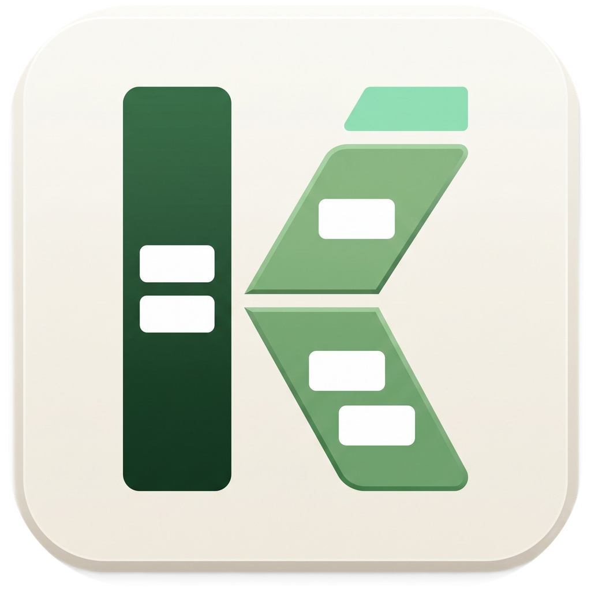
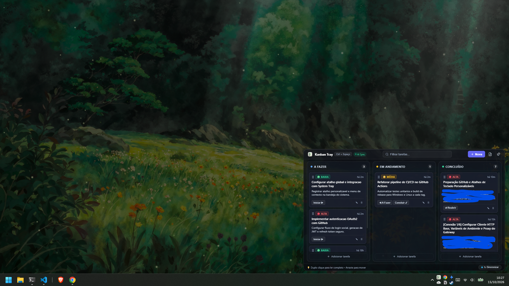
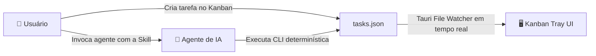

# ⚡ Kanban Tray

<p align="center">
  
</p>

<p align="center">
  <b>Gerenciador Kanban minimalista, translúcido e ultraleve que vive na bandeja do sistema (System Tray) do Windows, projetado para fluxo de trabalho em simbiose entre Desenvolvedores e Agentes Autônomos de IA.</b>
</p>


<p align="center">
  
  
  
  
  
</p>

---

## 📑 Índice

- [Parte 1: Visão Geral e Aspectos Úteis](#-parte-1-visão-geral-e-aspectos-úteis)
  - [O que é o Kanban Tray?](#o-que-é-o-kanban-tray)
  - [Interface e Temas (Como Alternar)](#interface-e-experiência-visual)
  - [Gerenciamento Completo de Tarefas](#gerenciamento-completo-de-tarefas)
  - [Personalização de Atalhos Globais (Passo a Passo)](#atalhos-globais-personalizáveis)
  - [Delegação Direta para Agentes de IA](#delegação-direta-para-agentes-de-ia)
- [Parte 2: Instalação, Uso e Integração com IA](#-parte-2-instalação-uso-e-integração-com-ia)
  - [Instalação Rápida (Binários Prontos)](#instalação-rápida-binários-prontos)
  - [Clonando e Executando a Partir do Código-Fonte](#clonando-e-executando-a-partir-do-código-fonte)
  - [Onde Encontrar e Como Instalar a Skill de IA](#onde-encontrar-e-como-instalar-a-skill-de-ia)
  - [Comandos da CLI Determinística](#comandos-da-cli-determinística)
- [Parte 3: Avisos, Limitações e Como Colaborar](#-parte-3-avisos-limitações-e-como-colaborar)
  - [Regra de Ouro: Nunca Edite `tasks.json` Diretamente](#regra-de-ouro-nunca-edite-tasksjson-diretamente)
  - [Limitações Atuais](#limitações-atuais)
  - [Roadmap & O que Falta](#roadmap--o-que-falta)
  - [Como Colaborar](#como-colaborar)

---

## 🌟 Parte 1: Visão Geral e Aspectos Úteis

### O que é o Kanban Tray?

O **Kanban Tray** é um aplicativo desktop nativo desenvolvido em **Tauri v2** e **Rust**. Ele permanece silenciosamente na bandeja do sistema (*System Tray*) do Windows, ocupando menos de **25 MB de memória RAM** e consumindo praticamente **0% de CPU** enquanto ocioso.

Com apenas um clique no ícone da bandeja ou pressionando o seu atalho global (como `Ctrl + Espaço`), a janela surge instantaneamente no canto da tela com acabamento translúcido e design escuro refinado.

### Interface e Experiência Visual

A aplicação foi desenhada para eliminar distrações e manter o foco no que realmente importa:



- **3 Colunas Lado a Lado:** *A Fazer*, *Em Andamento* e *Concluído* sempre visíveis ao mesmo tempo, sem necessidade de rolagem horizontal.
- **Dois Temas Integrados:**
  - **Minimal Obsidian Glass:** Estilo moderno, minimalista, monocromático, com botões pill sutis e vidro translúcido escuro.
  - **Dark Glass:** Tons escuros sofisticados com realces e acentos índigo suaves.
- **Janela Flutuante com Fixação (Pin):** Por padrão, a janela fecha suavemente ao clicar fora. Quer mantê-la aberta como referência durante o trabalho? Basta clicar no botão de **Fixar (Pin)** no cabeçalho.

> [!TIP]
> ### 🎨 Como Alternar Entre os Temas Disponíveis
> Você pode alternar entre o tema **Minimal Obsidian Glass** e **Dark Glass** de duas formas simples:
> 1. **Pelo Ícone da Aplicação:** Clique no pequeno ícone do Kanban localizado no canto superior esquerdo do cabeçalho da janela (ele possui uma animação tátil e altera o visual na hora).
> 2. **Por Atalho de Teclado:** Pressione `Ctrl + T` a qualquer momento enquanto a janela estiver aberta.
> 
> *A preferência de tema é persistida automaticamente no navegador/app e permanecerá ativa nas próximas aberturas!*

### Gerenciamento Completo de Tarefas

- **Arrastar e Soltar (Drag & Drop):** Mova tarefas livremente entre colunas usando o mouse com animações suaves e reordenação instantânea.
- **Visualização Completa com Duplo Clique:** Dê um duplo clique em qualquer cartão para abrir o modal de leitura detalhada com formatação completa, metadados de criação e botões de avanço rápido de status.
- **Filtro de Busca em Tempo Real:** Digite no campo de busca do cabeçalho para filtrar instantaneamente tarefas por título ou conteúdo da descrição.
- **Níveis de Prioridade Coloridos:** Classifique suas demandas com marcadores visuais:
  - 🟢 **Baixa** (Low)
  - 🟡 **Média** (Medium)
  - 🔴 **Alta** (High)

### Atalhos Globais Personalizáveis

Ao lado do título no cabeçalho, você encontra o botão indicador do atalho global ativo (por exemplo, `Ctrl + Espaço`). 

> [!TIP]
> ### ⌨️ Como Personalizar as Teclas de Atalho do Sistema
> O Kanban Tray permite definir qualquer combinação de teclas global para invocar a janela de qualquer lugar no Windows:
> 1. **Abra o Configurador:** Clique no botão cinza com a legenda do atalho atual (ex: `Ctrl + Espaço`), localizado no cabeçalho ao lado de *"Kanban Tray"*.
> 2. **Escolha seu Atalho:**
>    - **Gravar Teclas:** Clique na caixa de atalho selecionado e pressione no teclado a combinação que desejar (ex: `Alt + Espaço`, `Ctrl + Shift + K`, `Alt + K`, `F9`, etc.). A ferramenta valida modificadores e detecta a combinação em tempo real.
>    - **Atalhos Rápidos:** Se preferir, clique diretamente em uma das pílulas de sugestões prontas (`Ctrl + Espaço`, `Alt + Espaço`, `Ctrl + Shift + K`, `Alt + K`, `F9`).
> 3. **Salvar:** Clique em **"Salvar Atalho"**.
> 
> O backend em Rust registra o atalho imediatamente no Windows via `tauri-plugin-global-shortcut`, atualiza o rótulo do menu de contexto na bandeja do sistema (System Tray) e salva a preferência em `settings.json` sem necessidade de reiniciar a aplicação!

### Delegação Direta para Agentes de IA

O grande diferencial do **Kanban Tray** é a sua arquitetura voltada para automação assistida por Inteligência Artificial:



Basta pedir ao seu agente em linguagem natural:
> *"Use a skill kanban-tasks para pegar a tarefa mais urgente e começar a implementação."*

O agente:
1. Consulta a lista de tarefas.
2. Identifica a demanda de maior prioridade em *A Fazer*.
3. Move a tarefa para *Em Andamento* (`npm run task -- start <id>`).
4. Escreve o código, executa os testes e implementa a solução.
5. Move a tarefa para *Concluído* (`npm run task -- done <id>`).

Tudo isso é refletido **ao vivo na tela do Kanban Tray**, com indicador de pulso verde **AI Sync** no topo confirmando a sincronização instantânea.

---

## 🛠️ Parte 2: Instalação, Uso e Integração com IA

### Instalação Rápida (Binários Prontos)

Se você deseja apenas usar o aplicativo sem compilar o código:

1. Acesse a pasta [`app-release/`](app-release/).
2. Escolha o formato de sua preferência:
   - **Executável Portátil:** `kanban-tray.exe` (basta dar duplo clique para rodar).
   - **Instalador Padrão (NSIS):** `kanban-tray_0.1.0_x64-setup.exe`.
   - **Instalador Corporativo (MSI):** `kanban-tray_0.1.0_x64_en-US.msi`.
3. Para iniciar junto com o sistema, clique com o botão direito no ícone da bandeja e marque `☑ Iniciar com o Windows`.

### Clonando e Executando a Partir do Código-Fonte

#### Pré-requisitos:
- [Node.js](https://nodejs.org/) (versão 18 ou superior)
- [Rust & Cargo](https://rustup.rs/) (ferramentas de compilação C++ do Visual Studio / MSVC no Windows)

#### Passos:

```powershell
# 1. Clone o repositório
git clone https://github.com/seu-usuario/kanban-tray.git
cd kanban-tray

# 2. Instale as dependências do frontend
npm install

# 3. Inicialize o arquivo de tarefas local a partir do exemplo (se ainda não existir)
if (!(Test-Path "tasks.json")) { Copy-Item "tasks.example.json" "tasks.json" }

# 4. Execute em modo de desenvolvimento (com Hot Reload)
npm run tauri -- dev
```

#### Para gerar uma nova compilação de produção:

```powershell
npm run tauri -- build
```

> [!TIP]
> Após o build, execute `npm run clean` para remover os gigabytes de cache temporário do Rust (`target/`) e manter a pasta do projeto leve.

### Onde Encontrar e Como Instalar a Skill de IA

A skill pronta para agentes inteligentes está localizada dentro do repositório em:
📁 [`.agents/skills/kanban-tasks/`](.agents/skills/kanban-tasks/)

Ela é composta por:
- `SKILL.md`: Manifesto com as regras, instruções e ciclo de vida de tarefas para a IA.
- `scripts/`: Scripts auxiliares determinísticos em Node.js.
- `references/`: Arquitetura do protocolo de comunicação.

#### Como disponibilizar para sua IA:

- **Google Antigravity / Gemini CLI:**
  Copie a pasta `.agents/skills/kanban-tasks` para a pasta de skills do seu ambiente:
  ```powershell
  Copy-Item -Recurse ".agents\skills\kanban-tasks" "$HOME\.gemini\antigravity-cli\skills\kanban-tasks"
  ```
- **Claude Code / Cursor / Windsurf / Copilot Workspace:**
  Basta manter os arquivos de regras na raiz do projeto:
  - [`AGENTS.md`](AGENTS.md)
  - [`.ai-rules/tarefas_para_hoje.md`](.ai-rules/tarefas_para_hoje.md)
  Esses assistentes leem automaticamente as instruções e respeitam os comandos da CLI.

### Comandos da CLI Determinística

Tanto desenvolvedores humanos no terminal quanto agentes de IA devem interagir com a base de tarefas utilizando a CLI incluída no projeto:

| Ação | Comando | Exemplo |
| :--- | :--- | :--- |
| **Listar tarefas** | `npm run task -- list` | `npm run task -- list` |
| **Criar tarefa** | `npm run task -- add "<Título>" ["<Descrição>"] [low\|medium\|high]` | `npm run task -- add "Testes E2E" "Cobrir fluxo de checkout" high` |
| **Iniciar tarefa** | `npm run task -- start <id>` | `npm run task -- start task-mv9klwfm` |
| **Concluir tarefa** | `npm run task -- done <id>` | `npm run task -- done task-mv9klwfm` |
| **Voltar para A Fazer** | `npm run task -- todo <id>` | `npm run task -- todo task-mv9klwfm` |
| **Mover status** | `npm run task -- move <id> <todo\|in_progress\|done>` | `npm run task -- move task-123 done` |
| **Excluir tarefa** | `npm run task -- delete <id>` | `npm run task -- delete task-123` |

---

## ⚠️ Parte 3: Avisos, Limitações e Como Colaborar

### Regra de Ouro: Nunca Edite `tasks.json` Diretamente!

> [!CAUTION]
> **NUNCA EDITE O ARQUIVO `tasks.json` MANUALMENTE OU COM SCRIPTS DE ESCRITA DIRETA!**
> 
> A manipulação direta do arquivo JSON por editores ou prompts de IA pode causar perda acidental de tarefas, quebra de sintaxe JSON ou concorrência de leitura. 
> A CLI `npm run task -- ...` possui validação de campos, geração determinística de IDs, atualização automática de timestamps UTC e criação preventiva de backups (`tasks.json.bak`).

> [!IMPORTANT]
> **Privacidade no Git:** O arquivo `tasks.json` e suas configurações em `settings.json` estão protegidos no `.gitignore`. Nunca faça commit das suas tarefas particulares para o repositório público. Use sempre o `tasks.example.json` como modelo.

### Limitações Atuais

1. **Plataforma Exclusiva Windows:** Atualmente, os recursos de ancoragem na bandeja, translucidez via Windows DWM e cálculo dinâmico da barra de tarefas foram otimizados especificamente para **Windows 10 e Windows 11**.
2. **Armazenamento Local:** As tarefas residem em um arquivo JSON local na máquina do usuário. Não há backend em nuvem ou sincronização multi-dispositivo por padrão (embora você possa sincronizar a pasta via OneDrive ou Git privado).
3. **Sem Subtarefas Aninhadas:** No momento, cada cartão é uma unidade individual de trabalho, sem checklist aninhado dentro do cartão.

### Roadmap & O que Falta

- [ ] **Cross-Platform:** Suporte completo para macOS e distribuições Linux com bandeja moderna.
- [ ] **Notificações do Windows:** Disparar notificação nativa quando um agente de IA concluir uma tarefa em segundo plano.
- [ ] **Tags Customizadas:** Sistema de tags com cores personalizáveis por categoria (ex: `#frontend`, `#bug`, `#backend`).
- [ ] **Filtros Avançados:** Filtro por prioridade e ordenação por data de atualização.
- [ ] **Exportação / Importação:** Exportar tarefas em formato Markdown ou CSV.

### Como Colaborar

Contribuições da comunidade são muito bem-vindas! Se você deseja colaborar:

1. Faça um **Fork** do projeto.
2. Crie uma branch para a sua funcionalidade (`git checkout -b feature/minha-melhoria`).
3. Commit suas alterações (`git commit -m "feat: adiciona notificacoes nativas"`).
4. Faça o push para a branch (`git push origin feature/minha-melhoria`).
5. Abra um **Pull Request**.

Sinta-se livre para abrir [Issues](https://github.com/seu-usuario/kanban-tray/issues) reportando bugs, sugestões de novos temas ou ideias para integrações com novos frameworks de agentes de IA!

---

<p align="center">
  Feito com dedicação para uma experiência de desenvolvimento fluida entre humanos e IAs. 🚀
</p>

---
<p align="center">
  Aviso: Tanto este README quanto todo o código deste projeto foram gerados por ferramentas de inteligência artificial e não passaram por revisão independente. Embora a ocorrência de problemas seja considerada improvável, o proprietário deste repositório não se responsabiliza por quaisquer danos, diretos ou indiretos, decorrentes do uso deste material. 
</p>